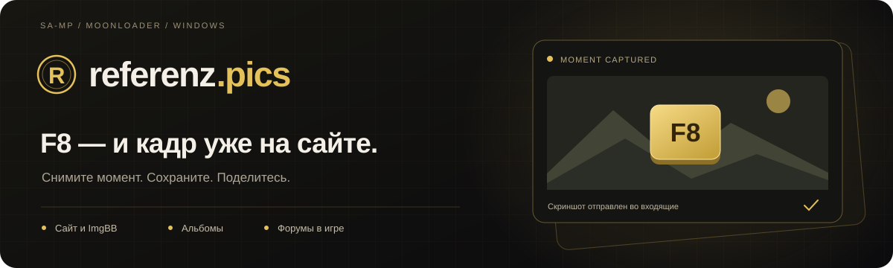
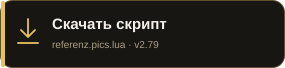
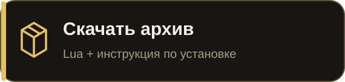
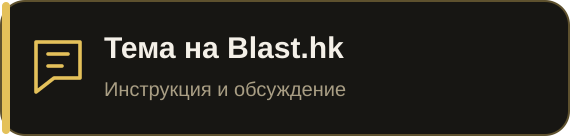
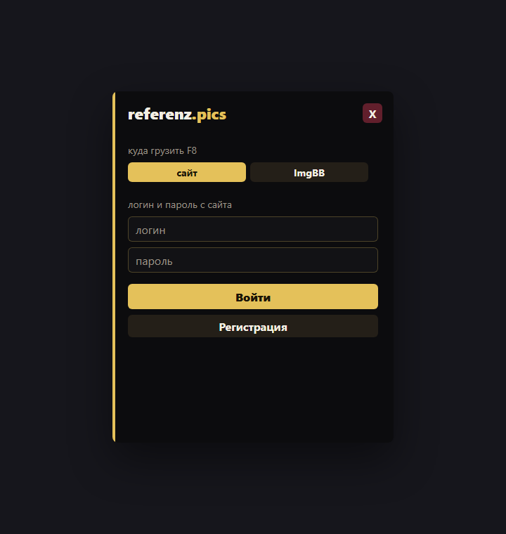
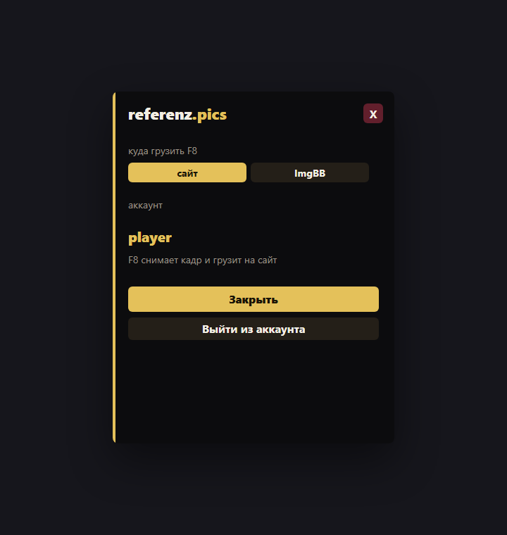

<p align="center">
  
</p>

<p align="center">
  <a href="https://github.com/andergr0ynd/referenz.pics/releases/latest/download/referenz.pics.lua"></a>
  &nbsp;
  <a href="https://github.com/andergr0ynd/referenz.pics/releases/latest/download/referenz.pics.zip"></a>
  &nbsp;
  <a href="https://www.blast.hk/threads/257840/"></a>
</p>

<p align="center">
  <strong>Версия 2.79</strong> · Windows · SA-MP · MoonLoader<br>
  Скриншоты из игры — на <a href="https://referenz.pics">referenz.pics</a> или ImgBB, одним нажатием <strong>F8</strong>.
</p>

<p align="center">
  <a href="#install">Установка</a> &nbsp;·&nbsp;
  <a href="#start">Первый запуск</a> &nbsp;·&nbsp;
  <a href="#features">Возможности</a> &nbsp;·&nbsp;
  <a href="#commands">Команды</a> &nbsp;·&nbsp;
  <a href="#faq">Вопросы</a> &nbsp;·&nbsp;
  <a href="https://referenz.pics">Открыть сайт</a>
</p>

---

## Сняли кадр — остальное на сайте

Нажмите **F8** в игре: скрипт снимет активное окно GTA и отправит кадр во входящие вашего аккаунта. На сайте можно оставить снимок приватным, открыть его по ссылке или опубликовать в ленте.

Если нужна прямая ссылка на изображение, выберите **ImgBB** — после загрузки ссылка появится в игровом чате и скопируется в буфер обмена.

<a id="install"></a>

## Установка за три шага

**1. Подготовьте игру.** Нужны **SA-MP**, **MoonLoader** и стандартные библиотеки вашей сборки, включая `inicfg`. Для полноценного интерфейса установите **mimgui**, для фоновых сетевых запросов — **effil** и **requests**. [Подробнее о зависимостях ↓](#dependencies)

**2. Скачайте [Lua-файл](https://github.com/andergr0ynd/referenz.pics/releases/latest/download/referenz.pics.lua)** и положите его в папку игры:

```text
GTA San Andreas/
└── moonloader/
    └── referenz.pics.lua
```

Можно скачать [архив](https://github.com/andergr0ynd/referenz.pics/releases/latest/download/referenz.pics.zip) и распаковать его в `moonloader`. В архиве — скрипт и инструкция; библиотеки устанавливаются отдельно.

**3. Зайдите в игру и введите `/referenz`.** Если игра уже запущена, сначала нажмите **Ctrl+R** или перезагрузите скрипты.

Кнопки GitHub скачивают файлы последнего релиза. Кнопка **«Тема на Blast.hk»** открывает инструкцию и обсуждение на форуме.

> [!TIP]
> Оставьте в `moonloader` одну копию скрипта. Для входа нужны **логин и пароль сайта**, а для загрузки на ImgBB — собственный API-ключ ImgBB.

<a id="start"></a>

## Первый запуск

1. Создайте аккаунт на [referenz.pics](https://referenz.pics) или через кнопку регистрации в скрипте.
2. Введите **`/referenz`** или **`/pics`** и войдите с логином и паролем сайта.
3. Выберите, куда отправлять снимки: **сайт** или **ImgBB**. Для ImgBB укажите ключ с [api.imgbb.com](https://api.imgbb.com/).
4. Закройте окно скрипта, оставьте игру активной и нажмите **F8**.
5. Для сайта откройте входящие в своём профиле. Для ImgBB возьмите готовую ссылку из чата или буфера обмена.

Если аккаунт создан через Telegram, Discord или Яндекс, сначала задайте пароль в **настройках сайта**. Социальный вход в браузере сам по себе не заменяет логин и пароль для `/referenz`.

<details>
<summary><strong>Как выглядит окно входа?</strong></summary>

<p align="center"></p>

Логин и пароль сохраняются локально. При следующем запуске скрипт пытается войти автоматически.

</details>

<details>
<summary><strong>Где выбрать сайт или ImgBB?</strong></summary>

<p align="center"></p>

Выбор сохраняется. Настройку можно изменить и на сайте; скрипт получает её при входе.

</details>

<a id="features"></a>

## Что умеет referenz.pics

| Возможность | Как работает |
| :--- | :--- |
| **Скриншот по F8** | Захват активного окна игры и отправка в выбранный сервис. |
| **Загрузка на сайт** | Кадр попадает во входящие аккаунта; видимость выбирается на сайте. |
| **Загрузка на ImgBB** | Прямая ссылка в чате и буфере обмена, с вашим API-ключом. |
| **Снимки и альбомы в игре** | Просмотр снимков, создание альбомов, перенос кадров и выбор видимости в интерфейсе mimgui. |
| **Форумы в игре** | Открытие сайтов Arizona, Blast, Rodina и Radmir во встроенном окне на WebView2. |
| **Повторный вход** | Сохранение настроек и попытка автоматической авторизации при запуске. |
| **Обновление с GitHub** | Проверка версии вручную или автоматически; после установки нужен перезапуск скрипта. |

### Куда отправляется снимок

| | **referenz.pics** | **ImgBB** |
| :--- | :--- | :--- |
| Что нужно | Аккаунт сайта | API-ключ ImgBB |
| Результат F8 | Снимок во входящих | Прямая ссылка на картинку |
| Где управлять | Профиль, альбомы и настройки сайта | Сервис ImgBB; последние ссылки доступны в скрипте |
| Видимость | Приватно, по ссылке или в ленте — по правилам сайта | По ссылке, согласно возможностям ImgBB |

**F8 отправляет изображение.** Это не запись видео; видео загружаются через сайт при доступной подписке.

<a id="commands"></a>

## Команды и клавиши

| Команда / клавиша | Действие |
| :--- | :--- |
| **`/referenz`** | Открыть окно входа или интерфейс аккаунта |
| **`/pics`** | То же самое |
| **F8** | Снять кадр активного окна игры и загрузить его |
| **`/referenz logout`** | Выйти из аккаунта и открыть вход |
| **`/referenz update`** | Проверить обновление |
| **`/refupdate`** | Быстрая команда проверки обновления |
| **Ctrl+R** | Перезагрузить скрипты MoonLoader, в том числе после обновления |

<a id="faq"></a>

## Если что-то не получается

<details>
<summary><strong>Не появляется окно /referenz</strong></summary>

Проверьте путь `moonloader/referenz.pics.lua` и перезагрузите скрипты. В `moonloader.log` не должно быть ошибки загрузки `inicfg` или других зависимостей. Для полного интерфейса требуется **mimgui**. При отсутствии ImGui используются стандартные диалоги входа SA-MP.

</details>

<details>
<summary><strong>«Нет связи с сайтом» или загрузка идёт слишком долго</strong></summary>

Проверьте, открывается ли [referenz.pics](https://referenz.pics) в браузере, затем повторите загрузку. Для фоновой работы сети установите **effil** и **requests**. Без них используется синхронный резервный транспорт Windows, который может задерживать игру до ответа сервера или тайм-аута.

</details>

<details>
<summary><strong>F8 не снимает кадр или просит закрыть окно</strong></summary>

Сделайте активным окно игры, закройте интерфейс скрипта и браузера в игре, затем нажмите F8 повторно. Дождитесь окончания предыдущей загрузки: повторные нажатия во время неё не запускают новую отправку.

</details>

<details>
<summary><strong>«Укажите ключ ImgBB»</strong></summary>

Выбран ImgBB, но ключ не заполнен. Получите ключ на [api.imgbb.com](https://api.imgbb.com/) и укажите его в окне `/referenz` либо переключитесь на загрузку на сайт.

</details>

<details>
<summary><strong>Вход через соцсеть работает на сайте, но не в игре</strong></summary>

Откройте **настройки сайта**, задайте пароль и используйте свой логин сайта в `/referenz`. В Lua не нужно вводить пароль Telegram, Discord или Яндекса. Если обычный аккаунт уже есть, привязывайте сервисы к нему в настройках.

</details>

<details>
<summary><strong>Как обновить скрипт?</strong></summary>

Введите **`/referenz update`** или **`/refupdate`**, дождитесь сообщения о сохранении файла и перезагрузите скрипты через **Ctrl+R**. Проверку при запуске можно отключить в интерфейсе.

Также можно скачать [актуальный Lua-файл](https://github.com/andergr0ynd/referenz.pics/releases/latest/download/referenz.pics.lua) вручную и заменить прежний. Настройки находятся в `moonloader/config/referenz.ini`; для обычного обновления удалять их не нужно.

</details>

<a id="dependencies"></a>

<details>
<summary><strong>Зависимости и содержимое репозитория</strong></summary>

**Основа:** Windows, GTA San Andreas / SA-MP, установленный [MoonLoader](https://www.blast.hk/threads/33418/) и стандартные библиотеки сборки (`ffi`, `inicfg`).

**Полный интерфейс:** [mimgui](https://github.com/THE-FYP/mimgui). Старый `imgui` поддерживает окно входа, но не весь интерфейс аккаунта.

**Фоновые запросы:** [effil](https://github.com/effil/effil) и `requests`, совместимые с вашей сборкой MoonLoader.

**Форумы:** Microsoft Edge WebView2 Runtime. Вспомогательные DLL WebView2 скрипт подготавливает при первом открытии браузера; для этого нужны интернет и PowerShell. Runtime устанавливается отдельно, если его нет в Windows.

| Файл / папка | Назначение |
| :--- | :--- |
| [referenz.pics.lua](referenz.pics.lua) | Опубликованный игровой скрипт |
| [version.json](version.json) | Версия и адрес для автообновления |
| [images](images) | Логотип, оформление README и снимки интерфейса |
| [.github/ISSUE_TEMPLATE](.github/ISSUE_TEMPLATE) | Форма сообщения об ошибке |

Этот репозиторий содержит **игровой Lua-скрипт**. Сам сервис доступен на [referenz.pics](https://referenz.pics).

</details>

---

### Нужна помощь или нашли ошибку?

[**Сообщить об ошибке →**](https://github.com/andergr0ynd/referenz.pics/issues/new?template=bug_report.yml) · [Обсуждение на Blast.hk](https://www.blast.hk/threads/257840/) · [Открыть сайт](https://referenz.pics)

Укажите версию скрипта, клиент SA-MP и текст ошибки из `moonloader.log`. Не прикладывайте пароли, API-ключи и файл `referenz.ini`.

<sub>referenz.pics для SA-MP · Автор — andergr0ynd.</sub>
